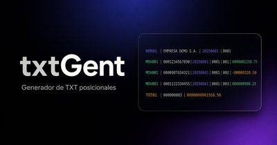

# Hi, I'm Fabio Ramos 👋

**Senior Full Stack Software Engineer · Co-Founder & Lead Software Engineer @ [CAW Tech](https://www.caw.com.ar)**

📍 Tucumán, Argentina · Remote

I build production web products end to end: architecture, product design, implementation, integrations and deployment. 5+ years across modern web apps, B2B/SaaS products and enterprise banking systems, where I tuned SQL and stored procedures for up to 60% faster financial reports.

---

### 🛠️ Stack

**Core:** TypeScript · JavaScript · React · Next.js · Supabase · SQL · PostgreSQL

**Backend / Data:** Node.js · Express · REST APIs · MongoDB · T-SQL · Sybase

**Also:** Tailwind CSS · shadcn/ui · Zustand · Vercel · Playwright · PowerBuilder · SOAP

---

### 🚀 Featured products

<table>
  <tr>
    <td width="40%" align="center" valign="middle">
      
    </td>
    <td valign="top">
      &nbsp;<b><a href="https://www.volleymanager.app/">Volley Manager</a></b>  
      Production SaaS/PWA for a professional volleyball club in Bolivia. Handles athletes, staff, attendance, payments and access control, plus coaching tools such as an interactive scouting court and voice-based scouting.  
      📊 <b>~700 athletes</b> · <b>~80% less manual work</b> · <b>165K+ requests/week with 99.9% success</b> · <b>15K+ visits since July 2026</b>  
      <code>Next.js</code> <code>TypeScript</code> <code>Supabase</code>
    </td>
  </tr>
  <tr>
    <td width="40%" align="center" valign="middle">
      
    </td>
    <td valign="top">
      &nbsp;<b><a href="https://www.expologic.online/">ExpoLogic</a></b>  
      Multi-tenant SaaS for cultural fairs and artisan markets, with interactive stand maps, reservations and waitlists, exhibitor pages and a 24/7 virtual fair.  
      📊 <b>Validated with two pilot clients and moving to production</b> · <b>one of 11 university finalists at Emprende U among 300+ projects</b> · <a href="https://niclen17.github.io/ExpoLogic-one-pager/">One-pager</a>  
      <code>Next.js</code> <code>TypeScript</code> <code>Supabase</code>
    </td>
  </tr>
  <tr>
    <td width="40%" align="center" valign="middle">
      
    </td>
    <td valign="top">
      &nbsp;<b><a href="https://www.txtgent.tech/">TxtGent</a></b>  
      Builds structured <code>.txt</code> documents from configurable templates, with a live preview and one-click download.  
      <code>React</code> <code>TypeScript</code> <code>Vite</code>
    </td>
  </tr>
</table>

**More work:** [legacy-ux-helper](https://github.com/NicLen17/legacy-ux-helper) · [utility-tool](https://github.com/NicLen17/utility-tool) · [La Leyenda](https://github.com/NicLen17/la-leyenda) · [MVP to Pro talk](https://niclen17.github.io/Lightning-Talk-MVP-to-PRO/)

---

### 📫 Links

🌐 [fabioramos.com.ar](https://www.fabioramos.com.ar/) · 💼 [LinkedIn](https://www.linkedin.com/in/fabioramosnic) · ✉️ [fabioramosnic@gmail.com](mailto:fabioramosnic@gmail.com)
